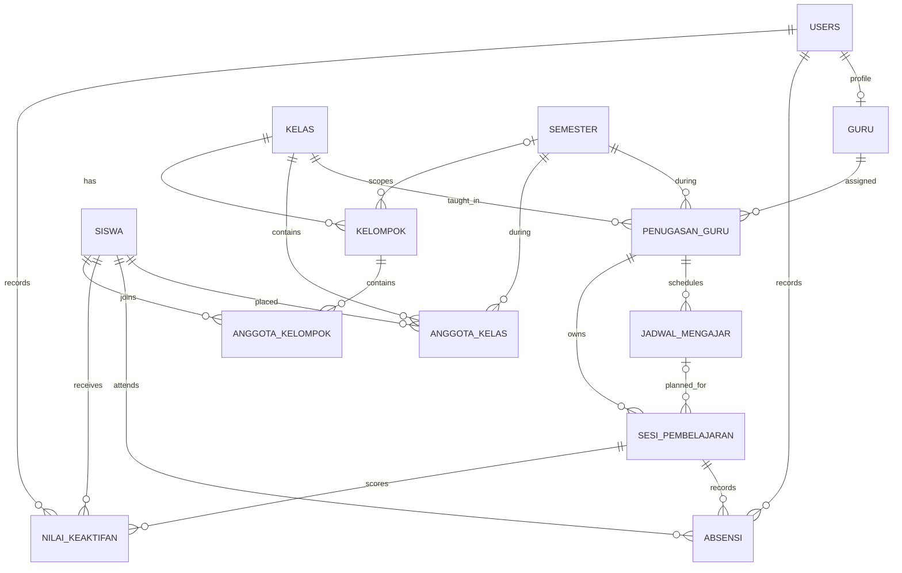

# ATTENDARA — ERD Panduan Database

## Tujuan dan status

Dokumen ini menjadi panduan rancangan data ATTENDARA untuk ditinjau sebelum implementasi. Aplikasi memakai PHP Native, PDO, dan MySQL. Role hanya **Admin** dan **Guru**; siswa tidak mempunyai akun. Admin mengelola data master, semester, penempatan siswa, penugasan dan jadwal guru. Guru mengelola absensi dan poin keaktifan pada sesi pembelajaran kelas yang ditugaskan kepadanya.

Riwayat penempatan, penugasan, sesi, absensi, dan poin harus tetap dapat ditelusuri. Tidak ada kenaikan kelas otomatis. Tipe data dan constraint di dokumen ini merupakan rancangan yang direncanakan; butir yang masih menunggu keputusan ditandai **Belum diputuskan** dan tidak boleh dianggap sebagai kebijakan bisnis final.

## Entitas dan atribut

Semua entitas menggunakan PK `id BIGINT UNSIGNED` kecuali `anggota_kelompok`, yang menggunakan PK gabungan. ID merupakan kandidat surrogate key. Waktu audit memakai `DATETIME`. Kolom yang tidak disebut nullable direncanakan `NOT NULL`, kecuali ditandai.

### `users` — akun Admin dan Guru

- `id BIGINT UNSIGNED` — PK.
- `username VARCHAR(100)` — NOT NULL.
- `password_hash VARCHAR(255)` — NOT NULL.
- `role VARCHAR(10)` — NOT NULL; nilai yang diizinkan `admin` atau `guru`.
- `is_active BOOLEAN` — NOT NULL.
- `created_at DATETIME`, `updated_at DATETIME` — NOT NULL.

### `guru` — profil guru

- `id BIGINT UNSIGNED` — PK.
- `user_id BIGINT UNSIGNED` — FK → `users.id`, UNIQUE; nullability menunggu keputusan apakah setiap guru wajib memiliki akun.
- `nomor_induk VARCHAR(50)` — NOT NULL.
- `nama VARCHAR(150)` — NOT NULL.
- `email VARCHAR(254)` — nullable.
- `no_telepon VARCHAR(30)` — nullable.
- `is_active BOOLEAN` — NOT NULL.
- `created_at DATETIME`, `updated_at DATETIME` — NOT NULL.

### `siswa` — data master siswa tanpa akun

- `id BIGINT UNSIGNED` — PK.
- `nomor_induk VARCHAR(50)` — NOT NULL.
- `nama VARCHAR(150)` — NOT NULL.
- `jenis_kelamin VARCHAR(20)` — nullable, hanya jika dibutuhkan.
- `tanggal_lahir DATE` — nullable.
- `is_active BOOLEAN` — NOT NULL.
- `created_at DATETIME`, `updated_at DATETIME` — NOT NULL.

### `kelas` — rombongan belajar

- `id BIGINT UNSIGNED` — PK.
- `kode VARCHAR(30)` — NOT NULL.
- `nama VARCHAR(100)` — NOT NULL.
- `tingkat TINYINT UNSIGNED` — nullable sampai format tingkat ditetapkan.
- `is_active BOOLEAN` — NOT NULL.
- `created_at DATETIME`, `updated_at DATETIME` — NOT NULL.

### `semester` — periode akademik

- `id BIGINT UNSIGNED` — PK.
- `kode VARCHAR(40)` — NOT NULL.
- `nama VARCHAR(100)` — NOT NULL.
- `tanggal_mulai DATE`, `tanggal_selesai DATE` — NOT NULL.
- `status VARCHAR(20)` — NOT NULL; nilai resmi dan definisi semester aktif menunggu keputusan.
- `created_at DATETIME`, `updated_at DATETIME` — NOT NULL.

### `anggota_kelas` — penempatan siswa per semester

- `id BIGINT UNSIGNED` — PK.
- `siswa_id BIGINT UNSIGNED` — FK → `siswa.id`, NOT NULL.
- `kelas_id BIGINT UNSIGNED` — FK → `kelas.id`, NOT NULL.
- `semester_id BIGINT UNSIGNED` — FK → `semester.id`, NOT NULL.
- `created_at DATETIME` — NOT NULL.

Admin membuat penempatan untuk semester baru; baris semester lama dipertahankan. Tidak ada promosi otomatis.

### `penugasan_guru` — guru yang ditugaskan pada kelas dan semester

- `id BIGINT UNSIGNED` — PK.
- `guru_id BIGINT UNSIGNED` — FK → `guru.id`, NOT NULL.
- `kelas_id BIGINT UNSIGNED` — FK → `kelas.id`, NOT NULL.
- `semester_id BIGINT UNSIGNED` — FK → `semester.id`, NOT NULL.
- `created_at DATETIME` — NOT NULL.

### `jadwal_mengajar` — pola/waktu jadwal dari penugasan

- `id BIGINT UNSIGNED` — PK.
- `penugasan_guru_id BIGINT UNSIGNED` — FK → `penugasan_guru.id`, NOT NULL.
- `hari TINYINT UNSIGNED` — NOT NULL; pemetaan angka ke hari perlu ditentukan.
- `jam_mulai TIME`, `jam_selesai TIME` — NOT NULL.
- `berlaku_mulai DATE`, `berlaku_sampai DATE` — nullable bila jadwal berlaku sepanjang penugasan.
- `created_at DATETIME`, `updated_at DATETIME` — NOT NULL.

### `sesi_pembelajaran` — pelaksanaan pembelajaran

- `id BIGINT UNSIGNED` — PK.
- `penugasan_guru_id BIGINT UNSIGNED` — FK → `penugasan_guru.id`, NOT NULL.
- `jadwal_mengajar_id BIGINT UNSIGNED` — FK → `jadwal_mengajar.id`, nullable jika sesi lepas diizinkan.
- `tanggal DATE` — NOT NULL.
- `waktu_mulai DATETIME`, `waktu_selesai DATETIME` — nullable sampai waktu sesi diketahui.
- `status VARCHAR(20)` — NOT NULL; daftar nilai menunggu keputusan.
- `created_at DATETIME`, `updated_at DATETIME` — NOT NULL.

Jika sesi menyimpan kedua FK penugasan dan jadwal, keduanya harus konsisten. Rencana integritasnya adalah FK komposit dari (`jadwal_mengajar_id`, `penugasan_guru_id`) ke pasangan unik pada `jadwal_mengajar`; alternatifnya validasi aplikasi yang transaksional. Ini mencegah jadwal milik penugasan lain dipasangkan ke sesi.

### `absensi` — status kehadiran siswa pada sesi

- `id BIGINT UNSIGNED` — PK.
- `sesi_pembelajaran_id BIGINT UNSIGNED` — FK → `sesi_pembelajaran.id`, NOT NULL.
- `siswa_id BIGINT UNSIGNED` — FK → `siswa.id`, NOT NULL.
- `status VARCHAR(30)` — NOT NULL; daftar status final menunggu keputusan.
- `dicatat_oleh_user_id BIGINT UNSIGNED` — FK → `users.id`, NOT NULL; harus akun Guru yang ditugaskan pada sesi.
- `waktu_dicatat DATETIME` — NOT NULL.
- `catatan VARCHAR(500)` — nullable.
- Kolom alasan ketidakhadiran belum dirancang; daftar alasan belum disetujui.

### `nilai_keaktifan` — poin keaktifan umum siswa pada sesi

- `id BIGINT UNSIGNED` — PK.
- `sesi_pembelajaran_id BIGINT UNSIGNED` — FK → `sesi_pembelajaran.id`, NOT NULL.
- `siswa_id BIGINT UNSIGNED` — FK → `siswa.id`, NOT NULL.
- `poin DECIMAL(7,2)` — NOT NULL; rentang dan nilai negatif menunggu keputusan.
- `dicatat_oleh_user_id BIGINT UNSIGNED` — FK → `users.id`, NOT NULL; harus akun Guru yang ditugaskan pada sesi.
- `waktu_dicatat DATETIME` — NOT NULL.
- `catatan VARCHAR(500)` — nullable.

Hanya satu jenis poin umum yang dimodelkan; tidak ada kolom kategori/jenis. Pemberian poin otomatis karena hadir belum diputuskan.

### `kelompok` — wadah pembagian siswa

- `id BIGINT UNSIGNED` — PK.
- `kelas_id BIGINT UNSIGNED` — FK → `kelas.id`, NOT NULL.
- `semester_id BIGINT UNSIGNED` — FK → `semester.id`, nullability bergantung apakah kelompok dibatasi per semester.
- `nama VARCHAR(100)` — NOT NULL.
- `created_at DATETIME`, `updated_at DATETIME` — NOT NULL.

### `anggota_kelompok` — keanggotaan siswa pada kelompok

- `kelompok_id BIGINT UNSIGNED` — FK → `kelompok.id`, PK bagian, NOT NULL.
- `siswa_id BIGINT UNSIGNED` — FK → `siswa.id`, PK bagian, NOT NULL.
- `created_at DATETIME` — NOT NULL.

## Relasi dan kardinalitas

- `users` 1 : 0..1 `guru` — profil guru terhubung ke akun; apakah setiap guru wajib punya akun belum diputuskan. Akun Admin tidak mempunyai profil guru.
- `siswa` 1 : N `anggota_kelas`; `kelas` 1 : N `anggota_kelas`; `semester` 1 : N `anggota_kelas`. `siswa` ↔ `kelas` adalah M:N lintas semester melalui `anggota_kelas`.
- `guru` 1 : N `penugasan_guru`; `kelas` 1 : N `penugasan_guru`; `semester` 1 : N `penugasan_guru`. Guru ↔ kelas adalah M:N lintas semester melalui `penugasan_guru`.
- `penugasan_guru` 1 : N `jadwal_mengajar` dan 1 : N `sesi_pembelajaran`.
- `jadwal_mengajar` 1 : 0..N `sesi_pembelajaran`; sisi sesi boleh opsional hanya jika sesi tanpa jadwal disetujui.
- `sesi_pembelajaran` 1 : N `absensi`; `siswa` 1 : N `absensi`. Sesi ↔ siswa adalah M:N melalui `absensi`.
- `sesi_pembelajaran` 1 : N `nilai_keaktifan`; `siswa` 1 : N `nilai_keaktifan`. Sesi ↔ siswa adalah M:N melalui `nilai_keaktifan`.
- `users` 1 : N `absensi` dan 1 : N `nilai_keaktifan` sebagai pencatat; keabsahan role dan penugasan guru harus divalidasi, bukan hanya dari FK.
- `kelas` 1 : N `kelompok`; `semester` 1 : 0..N `kelompok` bila kelompok berjangka semester.
- `kelompok` 1 : N `anggota_kelompok`; `siswa` 1 : N `anggota_kelompok`. Kelompok ↔ siswa adalah M:N melalui `anggota_kelompok`.

## Diagram ERD

## Unique constraint yang direncanakan

Constraint berikut menjadi kandidat finalisasi; kondisi “jika” menandai aturan yang masih harus diputuskan:

- `users(username)` — UNIQUE.
- `guru(user_id)` — UNIQUE untuk relasi akun-profil 1:1.
- `guru(nomor_induk)`, `siswa(nomor_induk)`, `semester(kode)` — UNIQUE setelah format dan cakupan identitas dikonfirmasi.
- `kelas(kode)` — UNIQUE global atau bersama rentang periode; cakupan belum diputuskan.
- `anggota_kelas(siswa_id, semester_id)` — UNIQUE jika satu kelas per siswa per semester.
- `penugasan_guru(guru_id, kelas_id, semester_id)` — UNIQUE jika satu penugasan per kombinasi; perlu identitas mata pelajaran jika ada beberapa penugasan dalam kombinasi itu.
- `jadwal_mengajar(id, penugasan_guru_id)` — UNIQUE sebagai dukungan FK komposit konsistensi sesi-jadwal-penugasan.
- `sesi_pembelajaran(jadwal_mengajar_id, tanggal)` — UNIQUE hanya jika satu sesi per jadwal per tanggal diputuskan.
- `absensi(sesi_pembelajaran_id, siswa_id)` — UNIQUE hanya jika paling banyak satu baris absensi final per pasangan.
- `nilai_keaktifan(sesi_pembelajaran_id, siswa_id)` — UNIQUE hanya jika satu nilai final per pasangan; jika perlu beberapa entri atau revisi, constraint ini tidak dipasang.
- `anggota_kelompok(kelompok_id, siswa_id)` — PK gabungan sekaligus mencegah duplikasi pasangan.
- `kelompok(kelas_id, semester_id, nama)` — kandidat unik bila kelompok dibatasi semester.

## Index yang direncanakan

MySQL memerlukan indeks untuk pemeriksaan FK; rencana implementasi perlu memastikan semua kolom FK memiliki indeks (InnoDB dapat membuat sebagian otomatis, tetapi daftar ini harus ditinjau eksplisit). Indeks komposit kandidat untuk query umum:

- `anggota_kelas(semester_id, kelas_id)` dan `anggota_kelas(siswa_id, semester_id)`.
- `penugasan_guru(semester_id, guru_id, kelas_id)` dan indeks pada `kelas_id`.
- `jadwal_mengajar(penugasan_guru_id, hari, jam_mulai)`.
- `sesi_pembelajaran(penugasan_guru_id, tanggal)` serta `jadwal_mengajar_id`.
- `absensi(sesi_pembelajaran_id, siswa_id)` dan `absensi(siswa_id, sesi_pembelajaran_id)` sesuai pola laporan.
- `nilai_keaktifan(sesi_pembelajaran_id, siswa_id)` dan `nilai_keaktifan(siswa_id, sesi_pembelajaran_id)` sesuai pola laporan.
- `kelompok(kelas_id, semester_id)` dan `anggota_kelompok(siswa_id)`.

Indeks UNIQUE yang sudah dipilih final akan sekaligus memenuhi sebagian kebutuhan pencarian; hindari indeks duplikat dengan prefiks yang sama setelah query aplikasi diketahui.

## Penjelasan desain dan integritas

- **Riwayat semester:** `anggota_kelas` dan `penugasan_guru` menyimpan FK semester pada setiap penempatan/penugasan. Data lama tidak ditimpa saat semester berganti. Penghapusan fisik semester/master yang sudah direferensikan sebaiknya ditolak; gunakan status arsip/nonaktif.
- **Akses guru:** absensi dan poin menautkan sesi; sesi menautkan penugasan; penugasan menautkan guru, kelas, semester. PHP harus memastikan user Guru yang melakukan perubahan adalah guru penugasan sesi. FK `dicatat_oleh_user_id` sendiri tidak cukup untuk otorisasi.
- **Edit absensi:** hanya izinkan perubahan ketika semester yang terkait sesi berstatus aktif. Aturan ini memerlukan transaksi/validasi di aplikasi pada setiap update; status semester tidak dapat diperiksa hanya oleh FK. Definisi tepat status aktif masih menunggu keputusan.
- **Konsistensi sesi-jadwal:** sesi menyimpan penugasan sebagai sumber konteks dan jadwal opsional. Constraint komposit yang direncanakan mencegah jadwal dari penugasan berbeda digunakan. Jika versi/kemampuan skema target tidak mendukung bentuk constraint yang dibutuhkan, validasi harus dilakukan di aplikasi.
- **Cegah data yatim:** seluruh relasi memakai FK. Penghapusan cascade tidak direncanakan pada data historis; gunakan RESTRICT dan penonaktifan master sebagai pola awal. Kebijakan akhir harus disetujui sebelum SQL.
- **Keanggotaan kelas valid:** FK terpisah belum menjamin siswa tercatat di kelas penugasan pada semester sesi. Validasi lintas relasi diperlukan; opsi FK komposit memerlukan kunci kandidat yang dirancang konsisten.
- **Kelompok:** FK anggota tidak menjamin siswa berasal dari kelas/semester yang sama. Aturan ini belum disepakati dan tidak diasumsikan.
- **Normalisasi:** jadwal (pola), sesi (kejadian), absensi, dan poin adalah fakta yang berbeda. Tabel penghubung mencegah daftar ID dalam kolom. Laporan dihitung dari fakta transaksi agar agregat salinan tidak kedaluwarsa.
- **Duplikasi:** constraint unik pada penempatan/penugasan/absensi/poin bergantung aturan kardinalitas. Jangan menerapkan constraint bersyarat sebelum keputusan terkait ditetapkan.

## Keputusan yang masih terbuka

Butir berikut tidak ditetapkan oleh aturan yang tersedia dan perlu persetujuan sebelum skema SQL:

1. Makna aturan absensi “2 detik” yang pernah dibahas.
2. Daftar final alasan ketidakhadiran.
3. Apakah siswa yang hadir memperoleh poin dasar otomatis.
4. Apakah kelompok berlaku per sesi, per semester, atau permanen.
5. Apakah satu siswa hanya mempunyai satu kelas per semester; apakah mutasi tengah semester dan riwayat tanggal diperlukan.
6. Apakah guru dapat memiliki beberapa penugasan untuk kelas sama di semester sama (misalnya mata pelajaran berbeda); apakah mata pelajaran perlu entitas master.
7. Apakah setiap guru wajib mempunyai akun; apakah username peka kapitalisasi; identitas unik resmi guru/siswa.
8. Apakah sesi tanpa jadwal diizinkan, dan apakah satu jadwal menghasilkan satu sesi per tanggal.
9. Apakah absensi/poin menyimpan satu nilai final atau beberapa percobaan/revisi dengan audit.
10. Definisi status semester aktif dan semester yang boleh diedit; apakah semester aktif tunggal dan periode boleh tumpang tindih.
11. Status absensi/sesi, rentang poin, nilai negatif, format hari, serta batas waktu sesi.
12. Cakupan unik kode kelas dan kebutuhan data kontak/atribut profil.
13. Kebijakan retensi/arsip, penghapusan, serta apakah perlu histori perubahan anggota kelompok.

## Perubahan dari ERD awal

- `accounts` dan `account_roles` disederhanakan menjadi `users` dengan satu kolom `role`, mengikuti dua role yang ditetapkan. Tidak ada akun atau relasi akun bagi siswa.
- `students`, `teachers`, `classes`, `semesters`, `student_placements`, `teaching_assignments`, `schedules`, `learning_sessions`, `attendance_records`, `participation_scores`, `student_groups`, dan `student_group_members` dinormalisasi ke nama tabel Indonesia yang dipakai di panduan.
- Token sesi dihapus dari rancangan karena aturan utama Fase 2 yang disetujui tidak menetapkannya sebagai kebutuhan wajib.
- `penugasan_guru` dipertahankan sebagai tabel tambahan agar hubungan guru-kelas-semester tidak bercampur dengan jadwal.
- Koordinat kelas/geolokasi tidak dimasukkan sebagai atribut final karena aturan bisnis Fase 2 tidak mensyaratkannya.
- Poin keaktifan ditetapkan sebagai satu jenis umum tanpa kategori, tetapi otomatisasi poin hadir tetap terbuka.
- Constraint unik pada penempatan, penugasan, absensi, dan poin diberi kondisi eksplisit agar tidak menyiratkan keputusan bisnis yang belum dibuat.

## Batas pekerjaan

Dokumen ini hanya panduan ERD. Tidak ada SQL, seed data, backend, frontend, atau implementasi CRUD. Tahap berikutnya menunggu persetujuan atas butir terbuka dan persetujuan eksplisit terhadap dokumen ERD ini.
